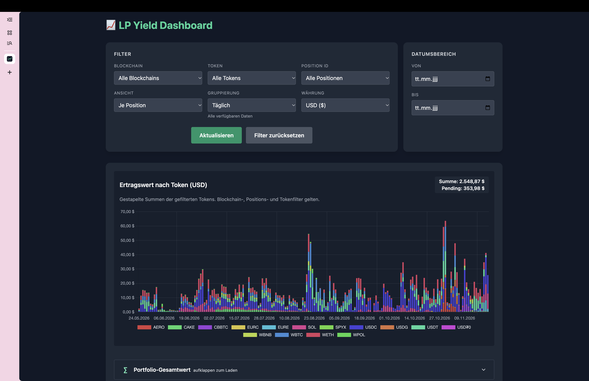
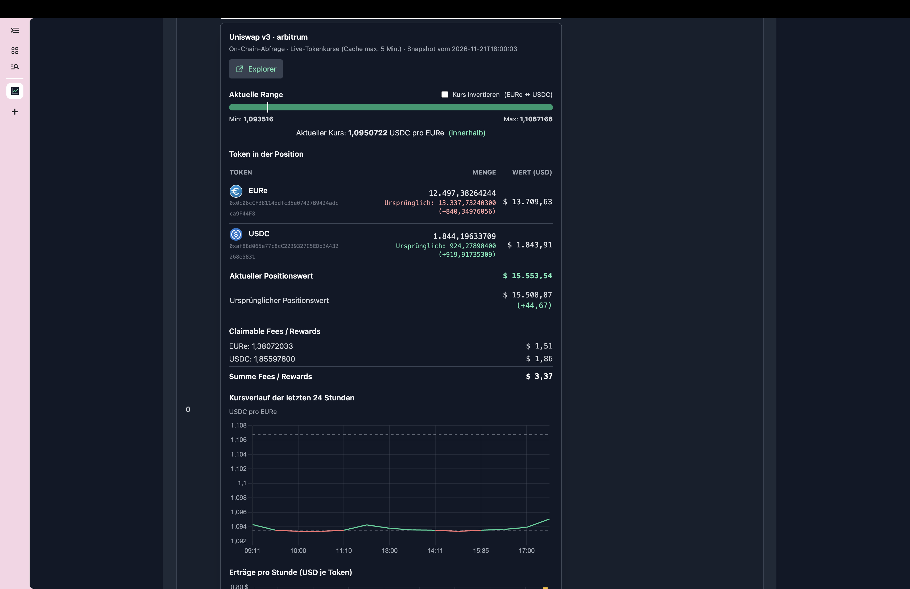
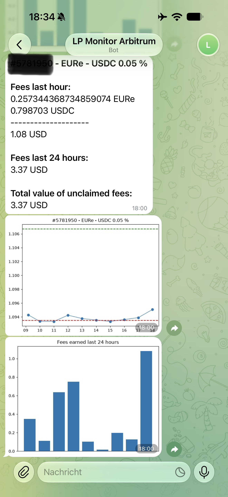

# LP Yield Dashboard

Das LP Yield Dashboard wertet Erträge aus Liquiditätspositionen aus und stellt
ihren Verlauf, aktuelle Positionen und Portfolio-Kennzahlen in einer
Weboberfläche dar. Ergänzende Notify-Skripte überwachen Gebühren und Rewards
verschiedener Liquidity-Pool-Protokolle und senden regelmäßige Berichte per
Telegram.

Die Anwendung liest Positions- und Ertragsdaten aus MariaDB und fragt für
aktuelle Positionsdetails zusätzlich Blockchain- und Kursdaten ab. Sie dient
der Beobachtung und Auswertung; die Skripte senden keine Transaktionen zum
Ändern oder Schließen von Positionen.

## Screenshots

Die Bilder liegen im Repository und werden auf GitHub direkt im README
angezeigt, sobald sie mit veröffentlicht werden.

### Dashboard und Ertragsübersicht



### Live-Details einer Position



### Telegram-Benachrichtigung



## Installation

Die interaktive Installation ist für Linux mit systemd vorgesehen. Starte sie
als normaler Benutzer aus dem Projektverzeichnis:

```sh
./install.sh
```

Alle nötigen Systemvoraussetzungen, Datenbank-, RPC- und Telegram-Zugänge
stehen in [SYSTEMVORAUSSETZUNGEN.md](SYSTEMVORAUSSETZUNGEN.md).

Das Script fragt zu Beginn, ob es zusätzlich die regelmäßigen Monitoring- und
Positionsimport-Timer installieren soll. Der Dashboard-Webdienst wird in jedem
Fall als systemd-Dienst eingerichtet und gestartet. Er ist nach der Installation
auf dem Server unter `http://127.0.0.1:8000` erreichbar. Der Dienst bindet
ausschließlich an localhost; für den Zugriff von anderen Rechnern kann ein
abgesicherter Reverse Proxy wie die unten beschriebene Apache-Konfiguration
verwendet werden.

Das Script prüft beziehungsweise installiert
MariaDB, legt standardmäßig die Datenbank `lpdashboard` an und importiert
`backup.sql` mit den benötigten Tabellenstrukturen. Der Dump enthält keine
Positions-, Ertrags- oder sonstigen Tabellendaten. Wenn die gewählte Datenbank
bereits existiert, wird vor dem Restore gefragt, da gleichnamige Tabellen
ersetzt werden und vorhandene Daten darin verloren gehen.

Anschließend richtet das Script eine virtuelle Python-Umgebung ein und
installiert die benötigten Python-Pakete. Zugangsdaten können während der
Eingabe ausgelassen werden; fehlende Werte werden am Ende mit dem Pfad der
jeweiligen Konfigurationsdatei aufgeführt. Die privaten Dateien werden aus den
Beispielen erstellt:
`.env` und `telegram.conf` im Projekt-Root sowie `.env` und `telegram.conf` in
den jeweiligen Notify-Verzeichnissen. Die Root-Telegram-Konfiguration wird für
Positionsimport-Meldungen verwendet. Ein gemeinsamer Telegram-Bot und Chat
werden für alle Skripte verwendet.

Die Monitoring- und Positionsimport-Timer werden nur auf Wunsch aktiviert und
wenn die erforderlichen Zugangsdaten vollständig sind. CoinTracking-Zugangsdaten
und die Aerodrome-Staker-Adresse sind optional. Der Webdienst wird unabhängig
davon installiert und beim Systemstart automatisch gestartet. Details zu
systemd-Status und Protokollen stehen in [systemd/README.md](systemd/README.md).

## Apache Reverse Proxy

Im Projekt-Root liegt mit [apache-lp-dashboard.conf](apache-lp-dashboard.conf)
eine Beispielkonfiguration für Apache auf Debian/Ubuntu. Sie leitet HTTP auf
HTTPS um, proxyt HTTPS-Anfragen an den lokal gebundenen Dashboard-Dienst und
schützt ihn mit HTTP Basic Authentication.

Vor der Aktivierung:

1. Richte einen DNS-Namen ein, der auf den Server zeigt, und stelle ein gültiges
   TLS-Zertifikat bereit. Ersetze in der Konfiguration `lp.example.com` und
   die Zertifikatspfade durch deine Werte. Das Beispiel erwartet ein
   Let's Encrypt-Zertifikat sowie
   `/etc/letsencrypt/options-ssl-apache.conf`.
2. Aktiviere die benötigten Apache-Module und erstelle eine Passwortdatei:

   ```sh
   sudo a2enmod ssl rewrite proxy proxy_http headers
   sudo htpasswd -c /etc/apache2/.lp-dashboard.htpasswd dashboarduser
   ```

   `htpasswd -c` erstellt die Datei neu. Für weitere Benutzer verwende
   denselben Befehl ohne `-c`, damit bestehende Einträge erhalten bleiben.
3. Kopiere die Beispielkonfiguration in die Apache-Site-Konfiguration,
   ersetze die Platzhalter und aktiviere die Site:

   ```sh
   sudo install -m 0644 apache-lp-dashboard.conf /etc/apache2/sites-available/lp-dashboard.conf
   sudo a2ensite lp-dashboard
   sudo apache2ctl configtest
   sudo systemctl reload apache2
   ```

   Die TLS-Dateien müssen bereits vorhanden und für Apache lesbar sein, bevor
   `configtest` erfolgreich sein kann. Verwende ein starkes Passwort und
   veröffentliche den Dashboard-Port `8000` nicht direkt im Netzwerk.

## Dashboard

### Erträge filtern und auswerten

Die Ertragshistorie wird aus den in der Datenbank erfassten Fee-Einträgen
geladen. Die Filter und Ansichten umfassen:

- **Blockchain**, **Token** und **Position-ID**
- **Offene Positionen** als Positionsfilter
- den **Datumsbereich** mit Start- und Enddatum
- Gruppierung nach **Tag**, **Woche**, **Monat** oder **Jahr**
- Anzeige der Gegenwerte in **USD** oder **EUR**
- die Ansichten **Je Position** und **Summen je Token-Symbol**

Das gestapelte Balkendiagramm zeigt den Gegenwert der Erträge nach Token und
Zeitraum. Die Tabelle darunter zeigt Ertragsmenge und Gegenwert sowie
Blockchain, Position und Zeitraum. Spalten lassen sich sortieren; die Anzahl
der sichtbaren Einträge ist einstellbar und die Tabelle ist paginiert.

In der Ansicht **Summen je Token-Symbol** wird die Tabelle über Blockchains
und Positionen hinweg aggregiert. Blockchain- und Positionsfilter werden dort
nicht auf die Tabelle angewendet; der Ertragsverlauf im Diagramm berücksichtigt
diese Filter weiterhin.

Wenn für einen Token kein Kurs verfügbar ist, bleiben seine Ertragsmengen
sichtbar. Der Gegenwert wird dann als nicht verfügbar markiert. Optional lassen
sich gezielt nur Einträge ohne ermittelbaren Kurs anzeigen. Fehlende Beträge
und Kursfehler werden ebenfalls kenntlich gemacht.

### Offene Positionen und Live-Details

Positionsdaten werden mit den jüngsten Snapshots der jeweiligen
Protokolltabellen verknüpft. Eine Position gilt für die Dashboard-Übersichten
als aktuell, wenn in der letzten Stunde ein Snapshot eingegangen ist. Über die
Position-ID lässt sich eine Position direkt filtern; das Protokollkürzel in der
Tabelle öffnet die zugehörigen Details.

Die Live-Details fragen beim Öffnen aktuelle On-Chain-Daten ab und zeigen,
soweit verfügbar:

- Protokoll, Blockchain, Snapshot-Zeitpunkt und einen Link zum Blockchain-
  Explorer
- den aktuellen Kurs im Verhältnis zur Positions-Range sowie, ob der Kurs
  innerhalb oder außerhalb der Range liegt
- eine umkehrbare Kursdarstellung für das Token-Paar
- Tokenmengen, aktuelle Gegenwerte und Veränderungen gegenüber den
  ursprünglichen Mengen und dem ursprünglichen Positionswert
- beanspruchbare Fees und Rewards mit Einzel- und Gesamtwert
- den Kursverlauf der letzten 24 Stunden und die stündlichen Erträge je Token
- Performance-Kennzahlen für Fees und Rewards, LP-Token-Wert, Gesamtrendite
  und Impermanent Loss

Die Live-Kursdaten werden höchstens fünf Minuten zwischengespeichert. Für
geschlossene, nicht unterstützte oder nicht vollständig bewertbare Positionen
zeigt das Dashboard einen entsprechenden Hinweis, statt einen vollständigen
Wert vorzutäuschen.

### Weitere Portfolio-Übersichten

Die folgenden Bereiche werden erst geladen, wenn sie aufgeklappt werden:

- **Portfolio-Gesamtwert:** aktueller Wert der offenen LP-Positionen plus
  CoinTracking-Bestände. LP-Token-Bestände aus CoinTracking werden dabei
  ausgeschlossen. Der Gesamtwert wird nur als vollständig ausgewiesen, wenn
  alle offenen LP-Positionen bewertet werden konnten.
- **Wertentwicklung aller Positionen:** aktueller LP-Token-Wert im Vergleich
  zum ursprünglichen Investitionswert, gesammelte Fees und kombinierte
  Veränderung. Die Liste lässt sich nach aktiven Positionen, Protokoll und
  Blockchain filtern und numerisch sortieren.
- **Token-Anteile:** aktuelle Tokenbestände in offenen Positionen,
  zusammengefasst nach Token-Symbol und mit Werten je Blockchain.

CoinTracking-Bestände werden über die CoinTracking-API geladen und für eine
Stunde zwischengespeichert. Token-Icons werden bei Bedarf lokal zwischengespeichert;
wenn kein Icon verfügbar ist, wird ein Symbol-Fallback angezeigt.

## Positionsimport und historische Einstandsdaten

`positions.py` ergänzt die Datenbank um historische Einstandsdaten zu
Liquiditätspositionen. Dazu ermittelt der Importer die ursprünglichen
Tokenmengen und den Einstandskurs anhand der On-Chain-Mint- beziehungsweise
Deposit-Daten sowie historischer Token- und Wechselkurse.

Unterstützt werden die konfigurierten Quelltabellen für:

- Uniswap auf Ethereum, Arbitrum, Polygon, Base, Optimism und Robinhood Chain
- PancakeSwap auf BNB Chain
- Aerodrome auf Base
- Orca und Raydium auf Solana

Bereits vollständig importierte Positionen werden übersprungen. Unvollständige
oder fehlgeschlagene Importe bleiben zur erneuten Verarbeitung gespeichert.
Nach erfolgreichem Import oder Aktualisieren sowie bei Importfehlern kann eine
Telegram-Nachricht gesendet werden.

## Notify-Skripte

Die protokollspezifischen Skripte lesen Positions-IDs beziehungsweise
Positionsadressen aus ihrer jeweiligen Konfiguration, erfassen regelmäßig
Snapshots und berechnen nicht beanspruchte Fees. Die Positionsberichte nennen
typischerweise Fees der letzten Stunde, Erträge der letzten 24 Stunden und
den aktuellen Gesamtwert nicht beanspruchter Fees. Dazu können ein
Kursdiagramm mit Range und ein Diagramm der Erträge der letzten 24 Stunden
gesendet werden.

| Skript | Netzwerk / Protokoll | Berichtsinhalte |
| --- | --- | --- |
| `notify/uniswap/ethereum/uniswap.py` | Uniswap auf Ethereum | Positionskurs, Range, Fees und Verlauf |
| `notify/uniswap/arbitrum/uniswap.py` | Uniswap auf Arbitrum | Positionskurs, Range, Fees und Verlauf |
| `notify/uniswap/polygon/uniswap.py` | Uniswap auf Polygon | Positionskurs, Range, Fees und Verlauf |
| `notify/uniswap/base/uniswap.py` | Uniswap auf Base | Positionskurs, Range, Fees und Verlauf |
| `notify/uniswap/robinhood/uniswap.py` | Uniswap auf Robinhood Chain | Positionskurs, Range, Fees und Verlauf |
| `notify/aero/aero.py` | Aerodrome Slipstream auf Base | Fees und Rewards, Positionskurs, Range und Verlauf |
| `notify/pancakeswap/cake.py` | PancakeSwap auf BNB Chain | Positionskurs, Range, Fees und Verlauf |
| `notify/orca/orca.py` | Orca Whirlpools auf Solana | Positionskurs, Range, Fees und Verlauf |
| `notify/raydium/raydium.py` | Raydium CLMM auf Solana | Positionskurs, Range, Fees und Verlauf |

### Zusammenfassende Ertragsberichte

Die Skripte unter `notify/uniswap/total/` erstellen netzwerkübergreifende
Berichte auf Basis der gespeicherten Erträge:

- **Stündlich:** summiert die am aktuellen Kalendertag erfassten Erträge nach
  Token, bewertet sie in USD und sendet Einzelwerte und Gesamtsumme.
- **Täglich:** fasst den vorherigen Kalendertag zusammen. Die Telegram-Nachricht
  enthält eine stündliche Ertragsübersicht sowie eine Aufteilung nach Token.
- **Monatlich:** fasst den vorherigen Kalendermonat zusammen und ergänzt die
  Tokenwerte um Tagesverläufe und eine Token-Aufteilung.

Die Einzelpositions- und Gesamtberichte werden über `telegram-send` an die
konfigurierte Telegram-Zieladresse gesendet. Die mitgelieferten systemd-Timer
sehen stündliche Positions- und Gesamtberichte, einen täglichen Bericht um
Mitternacht, einen Monatsbericht am ersten Tag des Monats sowie einen
Positionsimport alle fünf Minuten vor. Die tatsächliche Ausführung hängt davon
ab, welche Timer oder sonstige Zeitplanung auf dem jeweiligen System aktiviert
ist.

## Kursdaten und Datenhinweise

Für EVM-Netzwerke werden, soweit verfügbar, Chainlink-Preisfeeds verwendet;
für weitere Token und als Fallback kommt DexScreener zum Einsatz. Auf Solana
werden Pyth, Jupiter und DexScreener als Preisquellen beziehungsweise
Fallbacks verwendet. EUR-Umrechnungen basieren auf dem EUR/USD-Kurs.

Kursanbieter, RPC-Endpunkte oder die Datenbank können zeitweise nicht
verfügbar sein. In diesen Fällen werden betroffene Gegenwerte als nicht
verfügbar markiert und Hinweise auf unvollständige Summen angezeigt. Werte
sind Auswertungen der verfügbaren Snapshots und Kursdaten, keine Garantie für
einen tatsächlich erzielbaren Verkaufswert.
